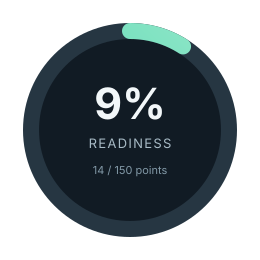
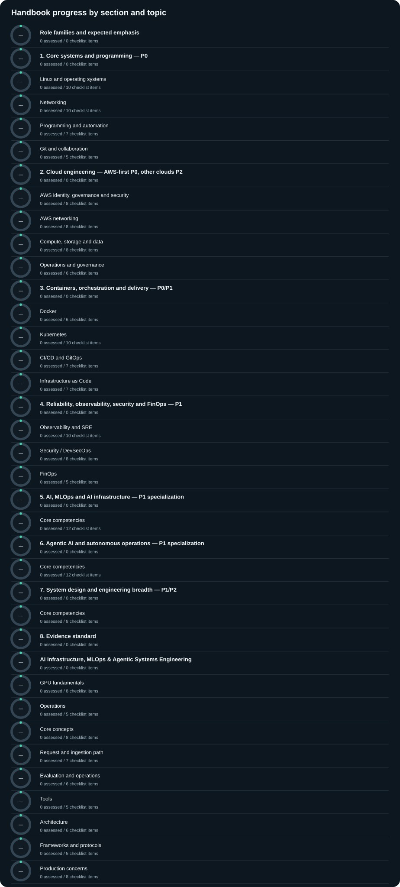

# Cloud & DevOps Engineering Handbook

A practical, evidence-driven handbook for **Cloud Engineering, DevOps, Platform Engineering, Site Reliability Engineering (SRE), AI Infrastructure, MLOps and Agentic AI Operations**.

**Primary positioning:** Cloud / DevOps Engineer with an AI infrastructure and agentic operations specialization.  
**Primary job market:** Pune, India · **Secondary:** Bengaluru, India.

This is a public learning system and engineering portfolio. It turns preparation into demonstrable capability through original notes, practical labs, troubleshooting records, architecture decisions, projects and interview practice.

## Start here

<!-- PREP-PROGRESS:START -->

<strong>10% overall baseline</strong> · 15/155 weighted points · 31 original broad competencies

### Preserved baseline

| Readiness stage | Broad competencies |
|---|---:|
| Not started | 16 |
| Learning | 15 |
| Lab completed | 0 |
| Documented | 0 |
| Interview tested | 0 |
| Interview ready | 0 |

**Project evidence:** 0/20 checks complete across 4 projects.

### Detailed handbook map

Every handbook section and topic has its own circular progress ring in the map below. Each individual checklist item has a separate readiness status. All newly split items begin as **Not assessed**; this is different from Not started. The original 9% baseline is preserved.

Expand topic breakdowns and every individual competency

#### Role families and expected emphasis

| Topic | Progress | Assessed / total |
|---|---:|---:|

#### 1. Core systems and programming — P0

| Topic | Progress | Assessed / total |
|---|---:|---:|
| **Linux and operating systems** | Not assessed | 0/10 |
| ↳ Filesystem hierarchy, mounts, inodes, symlinks, permissions, ownership, ACLs, umask | Not assessed | — |
| ↳ Users, groups, sudo, PAM basics, SSH keys and hardening | Not assessed | — |
| ↳ Processes, threads, signals, jobs, priorities, systemd, services and timers | Not assessed | — |
| ↳ CPU load, memory, swap, OOM killer, disk I/O, filesystem capacity | Not assessed | — |
| ↳ Logs: journald, syslog, log rotation, application logs | Not assessed | — |
| ↳ Package managers, repositories, kernel basics, boot sequence | Not assessed | — |
| ↳ Shell environment, pipes, redirection, grep, awk, sed, find, xargs, jq | Not assessed | — |
| ↳ Troubleshooting with ps, top/htop, free, vmstat, iostat, df, du, lsof, ss, journalctl, dmesg, strace | Not assessed | — |
| ↳ Linux networking: interfaces, routes, firewall, DNS resolver | Not assessed | — |
| ↳ Backup, restore, cron, systemd timers, process supervision | Not assessed | — |
| **Networking** | Not assessed | 0/10 |
| ↳ OSI and TCP/IP models; encapsulation and MTU | Not assessed | — |
| ↳ IPv4/IPv6, CIDR, subnetting, private/public ranges, route tables | Not assessed | — |
| ↳ ARP, ICMP, TCP handshake/teardown, UDP, ports, ephemeral ports | Not assessed | — |
| ↳ DNS records, recursive resolution, TTL, caching, split-horizon DNS | Not assessed | — |
| ↳ HTTP methods, status codes, headers, cookies, keep-alive, HTTP/2 and HTTP/3 concepts | Not assessed | — |
| ↳ TLS handshake, certificates, CA chain, SNI, mTLS | Not assessed | — |
| ↳ NAT, SNAT/DNAT, proxies, reverse proxies, load balancers | Not assessed | — |
| ↳ Firewalls, security groups, NACLs, stateful/stateless filtering | Not assessed | — |
| ↳ VPN, peering, transit routing, private endpoints, CDN | Not assessed | — |
| ↳ Packet-path troubleshooting, latency, packet loss, retransmission | Not assessed | — |
| **Programming and automation** | Not assessed | 0/7 |
| ↳ Bash: quoting, exit codes, traps, functions, arrays, strict mode, idempotence | Not assessed | — |
| ↳ Python: data structures, exceptions, modules, virtual environments, typing, logging | Not assessed | — |
| ↳ Files, JSON/YAML, CSV, HTTP APIs, pagination, retries, timeouts | Not assessed | — |
| ↳ Process execution safely, subprocess, environment variables | Not assessed | — |
| ↳ Unit tests, mocks, fixtures, linting, formatting and dependency pinning | Not assessed | — |
| ↳ API design basics, REST, authentication, status codes, schema validation | Not assessed | — |
| ↳ Concurrency basics, async I/O and thread/process distinctions | Not assessed | — |
| **Git and collaboration** | Not assessed | 0/5 |
| ↳ Working tree, index, commits, branches, tags, remotes, refs | Not assessed | — |
| ↳ Merge vs rebase, cherry-pick, revert, reset, reflog | Not assessed | — |
| ↳ Conflict resolution, interactive rebase, bisect | Not assessed | — |
| ↳ PR reviews, branch protection, CODEOWNERS, conventional commit practices | Not assessed | — |
| ↳ GitHub Actions, issues, releases, artifacts and permissions | Not assessed | — |

#### 2. Cloud engineering — AWS-first P0, other clouds P2

| Topic | Progress | Assessed / total |
|---|---:|---:|
| **AWS identity, governance and security** | Not assessed | 0/8 |
| ↳ IAM users, roles, policies, trust policies, permission boundaries, session policies | Not assessed | — |
| ↳ STS, AssumeRole, temporary credentials, federation and OIDC | Not assessed | — |
| ↳ Resource policies, identity policies, explicit deny and policy evaluation | Not assessed | — |
| ↳ Organizations, SCPs, account boundaries, Control Tower concepts | Not assessed | — |
| ↳ KMS, envelope encryption, key policies, rotation | Not assessed | — |
| ↳ Secrets Manager, SSM Parameter Store, certificate management | Not assessed | — |
| ↳ CloudTrail, Config, GuardDuty, Security Hub, Inspector, WAF and Shield concepts | Not assessed | — |
| ↳ Least privilege, access reviews, break-glass and audit evidence | Not assessed | — |
| **AWS networking** | Not assessed | 0/8 |
| ↳ VPC, CIDR, public/private subnets, route tables | Not assessed | — |
| ↳ Internet Gateway, NAT Gateway, egress-only gateway | Not assessed | — |
| ↳ Security Groups vs Network ACLs | Not assessed | — |
| ↳ VPC endpoints: gateway and interface; PrivateLink | Not assessed | — |
| ↳ VPC peering, Transit Gateway, VPN, Direct Connect concepts | Not assessed | — |
| ↳ Route 53 public/private hosted zones, health checks, routing policies | Not assessed | — |
| ↳ ALB, NLB, GWLB, target groups, health checks | Not assessed | — |
| ↳ CloudFront, origins, caching, TLS and WAF integration | Not assessed | — |
| **Compute, storage and data** | Not assessed | 0/8 |
| ↳ EC2 types, AMIs, user data, metadata, placement, EBS and snapshots | Not assessed | — |
| ↳ Auto Scaling Groups, launch templates, scaling policies | Not assessed | — |
| ↳ S3 storage classes, versioning, lifecycle, replication, encryption, bucket policies | Not assessed | — |
| ↳ EFS and FSx concepts; backup and restore | Not assessed | — |
| ↳ RDS, Multi-AZ, read replicas, backups, parameter groups | Not assessed | — |
| ↳ DynamoDB partition keys, indexes, capacity modes, TTL, streams | Not assessed | — |
| ↳ SQS, SNS, EventBridge, Kinesis concepts and delivery semantics | Not assessed | — |
| ↳ Lambda, API Gateway, Step Functions and event-driven design | Not assessed | — |
| **Operations and governance** | Not assessed | 0/6 |
| ↳ CloudWatch metrics, logs, alarms, dashboards, Logs Insights | Not assessed | — |
| ↳ CloudTrail event history and audit trails | Not assessed | — |
| ↳ AWS Backup, restore testing, RTO/RPO | Not assessed | — |
| ↳ Budgets, Cost Explorer, CUR, tagging, Savings Plans and Reserved Instances | Not assessed | — |
| ↳ Well-Architected pillars and trade-offs | Not assessed | — |
| ↳ Multi-account strategy, regions, availability zones and quotas | Not assessed | — |

#### 3. Containers, orchestration and delivery — P0/P1

| Topic | Progress | Assessed / total |
|---|---:|---:|
| **Docker** | Not assessed | 0/6 |
| ↳ Images, layers, registries, tags, digests and content trust concepts | Not assessed | — |
| ↳ Dockerfile, build context, cache, multi-stage builds, non-root user | Not assessed | — |
| ↳ Volumes, bind mounts, networks, DNS, port publishing | Not assessed | — |
| ↳ Compose services, health checks, depends_on semantics and profiles | Not assessed | — |
| ↳ Resource limits, logs, inspect, exec, events and pruning | Not assessed | — |
| ↳ Image scanning, SBOM, signing, minimal base images and secrets at build time | Not assessed | — |
| **Kubernetes** | Not assessed | 0/10 |
| ↳ Control plane, API server, etcd, scheduler, controller manager, kubelet, kube-proxy | Not assessed | — |
| ↳ Pods, Deployments, ReplicaSets, StatefulSets, DaemonSets, Jobs, CronJobs | Not assessed | — |
| ↳ Services, EndpointSlices, Ingress, Gateway API, DNS and network policies | Not assessed | — |
| ↳ ConfigMaps, Secrets, service accounts, RBAC and admission controls | Not assessed | — |
| ↳ Requests, limits, QoS, HPA, VPA concepts, PDB and scheduling constraints | Not assessed | — |
| ↳ Liveness, readiness, startup probes; rollout, rollback and disruption | Not assessed | — |
| ↳ PersistentVolumes, PVCs, StorageClasses, CSI | Not assessed | — |
| ↳ Namespaces, quotas, LimitRanges, affinity, taints and tolerations | Not assessed | — |
| ↳ CNI, CoreDNS, kube-proxy/eBPF concepts, cluster networking | Not assessed | — |
| ↳ Troubleshooting Pending, CrashLoopBackOff, OOMKilled, ImagePullBackOff, DNS and service routing | Not assessed | — |
| **CI/CD and GitOps** | Not assessed | 0/7 |
| ↳ Pipeline stages, runners, artifacts, caches, environments and approvals | Not assessed | — |
| ↳ Build/test/package/scan/sign/publish/deploy/verify/rollback | Not assessed | — |
| ↳ Secrets, OIDC federation, scoped tokens, runner isolation | Not assessed | — |
| ↳ Reproducible builds, immutable artifacts, provenance and SBOM | Not assessed | — |
| ↳ Deployment strategies: rolling, blue-green, canary, feature flags | Not assessed | — |
| ↳ GitOps reconciliation, drift, promotion and rollback | Not assessed | — |
| ↳ Pipeline security, dependency pinning and supply-chain controls | Not assessed | — |
| **Infrastructure as Code** | Not assessed | 0/7 |
| ↳ Terraform providers, resources, data sources, variables, outputs, locals | Not assessed | — |
| ↳ State, remote backends, locking, import, moved blocks, state recovery | Not assessed | — |
| ↳ Modules, version constraints, provider locks and environment separation | Not assessed | — |
| ↳ Plan/apply/destroy lifecycle, drift, dependency graph and lifecycle meta-arguments | Not assessed | — |
| ↳ Secrets and sensitive values; state encryption and access controls | Not assessed | — |
| ↳ Policy-as-code, validation and CI plan review | Not assessed | — |
| ↳ Configuration management and immutable infrastructure concepts | Not assessed | — |

#### 4. Reliability, observability, security and FinOps — P1

| Topic | Progress | Assessed / total |
|---|---:|---:|
| **Observability and SRE** | Not assessed | 0/10 |
| ↳ Metrics, logs, traces, events and correlation IDs | Not assessed | — |
| ↳ RED and USE methods; cardinality and sampling | Not assessed | — |
| ↳ Prometheus, PromQL, exporters, Alertmanager | Not assessed | — |
| ↳ Grafana dashboards, alert routing and runbooks | Not assessed | — |
| ↳ OpenTelemetry SDK, Collector, OTLP and context propagation | Not assessed | — |
| ↳ SLIs, SLOs, error budgets, burn-rate alerts and availability math | Not assessed | — |
| ↳ Incident command, severity, communication, timeline and postmortem | Not assessed | — |
| ↳ Capacity planning, load testing, saturation and graceful degradation | Not assessed | — |
| ↳ Backups, restore drills, RTO, RPO, HA and disaster recovery | Not assessed | — |
| ↳ Chaos engineering and resilience testing | Not assessed | — |
| **Security / DevSecOps** | Not assessed | 0/8 |
| ↳ Threat modeling, attack surface and trust boundaries | Not assessed | — |
| ↳ IAM least privilege, RBAC, network segmentation and workload identity | Not assessed | — |
| ↳ Secret management, rotation and secret scanning | Not assessed | — |
| ↳ SAST, DAST, SCA, container/IaC scanning | Not assessed | — |
| ↳ SBOM, signing, provenance and dependency pinning | Not assessed | — |
| ↳ Kubernetes security contexts, Pod Security Standards and admission policy | Not assessed | — |
| ↳ Encryption in transit/at rest, key management, audit logging | Not assessed | — |
| ↳ Vulnerability triage, patching, incident response and evidence retention | Not assessed | — |
| **FinOps** | Not assessed | 0/5 |
| ↳ Cost allocation, tags/labels, budgets, forecasts and anomaly detection | Not assessed | — |
| ↳ Compute, storage, network egress, logs and idle resource cost drivers | Not assessed | — |
| ↳ Rightsizing, autoscaling, spot/preemptible trade-offs | Not assessed | — |
| ↳ Unit economics, cost per request, cost per workload and showback | Not assessed | — |
| ↳ GPU utilization, model token cost and inference cost per request | Not assessed | — |

#### 5. AI, MLOps and AI infrastructure — P1 specialization

| Topic | Progress | Assessed / total |
|---|---:|---:|
| **Core competencies** | Not assessed | 0/12 |
| ↳ Python for services, data pipelines, async APIs and packaging | Not assessed | — |
| ↳ ML lifecycle: datasets, training, validation, model registry and deployment | Not assessed | — |
| ↳ LLM basics: tokens, context windows, embeddings, attention, quantization | Not assessed | — |
| ↳ Inference: batching, streaming, KV cache, concurrency, latency and throughput | Not assessed | — |
| ↳ GPU fundamentals: VRAM, CUDA concepts, drivers, utilization and scheduling | Not assessed | — |
| ↳ Model serving: vLLM, Hugging Face TGI, Triton, Ollama (compare use cases) | Not assessed | — |
| ↳ RAG: ingestion, chunking, embeddings, retrieval, reranking and citations | Not assessed | — |
| ↳ Vector databases: pgvector, Qdrant, Milvus, Weaviate concepts | Not assessed | — |
| ↳ AI gateways, model routing, rate limits, caching, quotas and provider failover | Not assessed | — |
| ↳ MLOps: MLflow, Kubeflow, KServe, feature/data versioning and model monitoring | Not assessed | — |
| ↳ LLM evaluation, prompt/version tests, quality, latency and cost metrics | Not assessed | — |
| ↳ AI security: prompt injection, data leakage, model supply chain and tool abuse | Not assessed | — |

#### 6. Agentic AI and autonomous operations — P1 specialization

| Topic | Progress | Assessed / total |
|---|---:|---:|
| **Core competencies** | Not assessed | 0/12 |
| ↳ Agent loop, state, planning, tool selection and termination | Not assessed | — |
| ↳ Tool contracts, JSON schema, validation, timeouts, retries and idempotency | Not assessed | — |
| ↳ MCP architecture: host, client, server, tools, resources and prompts | Not assessed | — |
| ↳ Workflow orchestration vs autonomous agents; deterministic boundaries | Not assessed | — |
| ↳ LangGraph concepts: state graph, nodes, edges, checkpoints and human interrupts | Not assessed | — |
| ↳ Multi-agent patterns, delegation, shared state and coordination failure | Not assessed | — |
| ↳ Memory, retrieval, context management and data retention | Not assessed | — |
| ↳ Agent tracing, evaluations, regression sets and adversarial tests | Not assessed | — |
| ↳ Guardrails: read-only defaults, allowlists, approvals, budgets and kill switches | Not assessed | — |
| ↳ Audit logs, provenance, identity, tenant isolation and secret boundaries | Not assessed | — |
| ↳ AIOps: alert triage, log summarization, incident correlation and remediation proposals | Not assessed | — |
| ↳ Safe remediation: dry run, blast-radius estimate, approval, execution and verification | Not assessed | — |

#### 7. System design and engineering breadth — P1/P2

| Topic | Progress | Assessed / total |
|---|---:|---:|
| **Core competencies** | Not assessed | 0/8 |
| ↳ Load balancing, caching, CDN, database scaling and queue-based decoupling | Not assessed | — |
| ↳ Consistency, replication, partitioning, CAP trade-offs and failure domains | Not assessed | — |
| ↳ Retries, timeouts, backoff, jitter, circuit breakers and bulkheads | Not assessed | — |
| ↳ Idempotency, deduplication, ordering and at-least-once delivery | Not assessed | — |
| ↳ API gateways, service discovery, authentication and authorization | Not assessed | — |
| ↳ Relational vs NoSQL data modeling, indexes, transactions and connection pools | Not assessed | — |
| ↳ High availability, multi-AZ/region, backup, restore and disaster recovery | Not assessed | — |
| ↳ Secure-by-default architecture, observability and cost estimation | Not assessed | — |

#### 8. Evidence standard

| Topic | Progress | Assessed / total |
|---|---:|---:|

#### AI Infrastructure, MLOps & Agentic Systems Engineering

| Topic | Progress | Assessed / total |
|---|---:|---:|
| **GPU fundamentals** | Not assessed | 0/8 |
| ↳ GPU vs CPU workloads; parallelism and memory bandwidth. | Not assessed | — |
| ↳ VRAM capacity, utilization, fragmentation and allocation. | Not assessed | — |
| ↳ CUDA concepts, drivers, runtime and compatibility. | Not assessed | — |
| ↳ Multi-GPU concepts: data parallelism, tensor parallelism and pipeline parallelism. | Not assessed | — |
| ↳ GPU scheduling, device plugins, node labels, taints and topology awareness. | Not assessed | — |
| ↳ MIG and GPU sharing concepts where supported. | Not assessed | — |
| ↳ PCIe/NVLink concepts and data transfer bottlenecks. | Not assessed | — |
| ↳ Thermal, power and hardware health signals. | Not assessed | — |
| **Operations** | Not assessed | 0/5 |
| ↳ Driver/runtime compatibility and container GPU access. | Not assessed | — |
| ↳ GPU telemetry and utilization dashboards. | Not assessed | — |
| ↳ Node pool isolation, quotas and workload priority. | Not assessed | — |
| ↳ Capacity planning based on model size, context, concurrency and throughput. | Not assessed | — |
| ↳ Failure handling for unhealthy GPUs and unavailable capacity. | Not assessed | — |
| **Core concepts** | Not assessed | 0/8 |
| ↳ Time to first token (TTFT), time per output token (TPOT), tokens/second and end-to-end latency. | Not assessed | — |
| ↳ Continuous batching, static batching and dynamic batching. | Not assessed | — |
| ↳ KV cache and context length. | Not assessed | — |
| ↳ Concurrency, queue depth, backpressure, rate limiting and admission control. | Not assessed | — |
| ↳ Quantization and quality/performance trade-offs. | Not assessed | — |
| ↳ Model warm-up, cold starts, autoscaling and graceful shutdown. | Not assessed | — |
| ↳ Model routing, fallback, provider outages and circuit breaking. | Not assessed | — |
| ↳ Streaming responses, cancellation and client disconnects. | Not assessed | — |
| **Request and ingestion path** | Not assessed | 0/7 |
| ↳ Document ingestion, parsing, normalization and access-control metadata. | Not assessed | — |
| ↳ Chunking strategy, overlap, metadata and source identifiers. | Not assessed | — |
| ↳ Embedding model selection and versioning. | Not assessed | — |
| ↳ Vector storage, indexing and similarity search. | Not assessed | — |
| ↳ Hybrid retrieval, filters and reranking. | Not assessed | — |
| ↳ Context assembly, prompt construction and generation. | Not assessed | — |
| ↳ Source attribution, citation mapping and response validation. | Not assessed | — |
| **Evaluation and operations** | Not assessed | 0/6 |
| ↳ Retrieval recall/precision and ranking quality. | Not assessed | — |
| ↳ Answer relevance, faithfulness and groundedness. | Not assessed | — |
| ↳ Freshness, re-indexing, deletion propagation and access revocation. | Not assessed | — |
| ↳ Tenant isolation and row/document-level authorization. | Not assessed | — |
| ↳ Cache invalidation and embedding model migration. | Not assessed | — |
| ↳ Latency, storage, token and retrieval cost. | Not assessed | — |
| **Tools** | Not assessed | 0/5 |
| ↳ [pgvector](https://github.com/pgvector/pgvector) — vector search inside PostgreSQL. | Not assessed | — |
| ↳ [Qdrant](https://qdrant.tech/documentation/) — vector search engine. | Not assessed | — |
| ↳ [Milvus](https://milvus.io/docs) — vector database. | Not assessed | — |
| ↳ [Weaviate](https://weaviate.io/developers/weaviate) — vector database. | Not assessed | — |
| ↳ [LlamaIndex](https://docs.llamaindex.ai/) — data and retrieval application framework. | Not assessed | — |
| **Architecture** | Not assessed | 0/6 |
| ↳ User or event trigger → orchestrator → model → tool selection → tool execution → result validation → state update → final response. | Not assessed | — |
| ↳ Deterministic workflow for known steps; agent reasoning only where ambiguity adds value. | Not assessed | — |
| ↳ Typed state, structured outputs, checkpoints and explicit termination conditions. | Not assessed | — |
| ↳ Tool schemas, validation, authorization, idempotency and bounded retries. | Not assessed | — |
| ↳ Human approval interrupts for high-impact actions. | Not assessed | — |
| ↳ Memory and retrieval separated from trusted policy and system instructions. | Not assessed | — |
| **Frameworks and protocols** | Not assessed | 0/5 |
| ↳ [Model Context Protocol](https://modelcontextprotocol.io/) — interoperability for exposing tools and context; understand hosts, clients, servers, tools, resources and prompts. | Not assessed | — |
| ↳ [LangGraph](https://docs.langchain.com/oss/python/langgraph/overview) — stateful graph orchestration, persistence and human-in-the-loop workflows. | Not assessed | — |
| ↳ [LangChain](https://docs.langchain.com/oss/python/langchain/overview) — application components and agent abstractions. | Not assessed | — |
| ↳ [LlamaIndex](https://docs.llamaindex.ai/) — data ingestion and retrieval-oriented applications. | Not assessed | — |
| ↳ [OpenAI API documentation](https://platform.openai.com/docs/) — model/API concepts; confirm current API features in official docs. | Not assessed | — |
| **Production concerns** | Not assessed | 0/8 |
| ↳ Tool permission boundaries and workload identity. | Not assessed | — |
| ↳ Prompt injection from logs, tickets, documents and command output. | Not assessed | — |
| ↳ Data exfiltration and cross-tenant leakage. | Not assessed | — |
| ↳ Tool output treated as untrusted data, never as policy. | Not assessed | — |
| ↳ Run budgets, token limits, deadlines, cancellation and kill switch. | Not assessed | — |
| ↳ Trace IDs, tool input/output audit, versioned prompts and replay. | Not assessed | — |
| ↳ Evaluation datasets, deterministic mocks and regression tests. | Not assessed | — |
| ↳ Human approval, change plans, dry-runs and post-action verification. | Not assessed | — |

**Scoring:** Each assessed item receives 0–5 points across the six readiness stages. Topic and section percentages are weighted averages of assessed child items. Unassessed items are excluded until evaluated and never counted as completed.

Edit progress.json to update any individual status or project evidence check. GitHub Actions regenerates the README map and SVG on push.
<!-- PREP-PROGRESS:END -->

| Start point | What it contains |
|---|---|
| [Skill & Tool Matrix](SKILL-MATRIX.md) | Full role-based inventory across Cloud, DevOps, SRE, Platform, AI infrastructure and agentic engineering |
| [Project Readiness](PROJECT-READINESS.md) | Portfolio status, evidence gates and project priority order |
| [Interview Question Bank](INTERVIEW-QUESTION-BANK.md) | 210 original practice questions across 13 engineering domains |
| [Scenario Playbook](SCENARIO-PLAYBOOK.md) | 100 production troubleshooting, design and incident scenarios |
| [AI Infrastructure Curriculum](AI-INFRASTRUCTURE.md) | GPU, inference, RAG, MLOps, LLM platforms, MCP, agents and AIOps |
| [Roadmap](ROADMAP.md) | Accelerated, competency-based progression—not a one-week-per-topic schedule |
| [Progress Tracker](PROGRESS.md) | Evidence-backed written progress log |
| [Interview Tracker](INTERVIEW-TRACKER.md) | Company, topic and mock-interview tracking |
| [Resource Index](RESOURCE-INDEX.md) | External interview repositories, labs and engineering references |

## Handbook map

| Area | Purpose |
|---|---|
| [00 — Foundations](00-foundations/README.md) | Linux, networking, operating systems, troubleshooting |
| [01 — Programming](01-programming/README.md) | Bash, Python, APIs and automation |
| [02 — Version control](02-version-control/README.md) | Git, GitHub and collaboration |
| [03 — Cloud](03-cloud/README.md) | AWS-first cloud engineering, architecture and operations |
| [04 — Containers](04-containers/README.md) | Docker, Compose and troubleshooting |
| [05 — Orchestration](05-orchestration/README.md) | Kubernetes |
| [06 — CI/CD](06-cicd/README.md) | GitHub Actions, pipelines and deployment |
| [07 — Infrastructure as Code](07-infrastructure-as-code/README.md) | Terraform and configuration management |
| [08 — Observability & SRE](08-observability-sre/README.md) | Metrics, logs, alerting, SLOs and incidents |
| [09 — Security & FinOps](09-security-finops/README.md) | Cloud security and cost |
| [10 — Agentic DevOps](10-agentic-devops/README.md) | Tool-using agents, evaluations and guardrails |
| [11 — Projects](11-projects/README.md) | Portfolio projects and implementation evidence |
| [12 — Interview preparation](12-interview-preparation/README.md) | Role-based questions, scenarios and mock interviews |
| [13 — System design](13-system-design/README.md) | Cloud architecture and distributed systems |
| [14 — Resources](14-resources/README.md) | Official docs, articles, videos and job descriptions |
| [15 — Practical labs](15-practical-labs/README.md) | Reproducible exercises and validation evidence |
| [16 — Engineering case studies](16-engineering-case-studies/README.md) | Production incidents and architecture analysis |
| [17 — Interview intelligence](17-interview-intelligence/README.md) | Question practice, company reports and mock tracking |
| [Templates](templates/README.md) | Consistent formats for topics, labs and interviews |

## Target role families

- DevOps Engineer
- Cloud Engineer / Cloud Operations Engineer
- Platform Engineer
- Site Reliability Engineer (SRE)
- Cloud Support / Infrastructure Support / Build & Release
- AI Infrastructure Engineer / LLM Platform Engineer
- MLOps Engineer
- Agentic AI / AIOps Engineer

Agentic AI is a specialization layered on top of sound infrastructure fundamentals. The goal is to demonstrate safe, useful AI-assisted operations—not to claim expertise in every framework.

## How to use this handbook

1. Pick one P0 skill from the skill matrix.
2. Learn the mechanism from official documentation and explain it in your own words.
3. Complete a reproducible practical lab.
4. Break a safe test environment and diagnose the failure.
5. Answer related questions without looking at notes.
6. Update progress only when evidence supports the status.

### Topic readiness states

Not started → Learning → Lab completed → Documented → Interview tested → Interview ready.

A topic is not interview-ready because a video or article was completed. You should be able to explain, demonstrate and troubleshoot it independently.

## Engineering standards

- Prefer official documentation for technical behaviour.
- Record versions, environment assumptions and access dates where relevant.
- Distinguish verified behaviour from assumptions and untested hypotheses.
- Never publish credentials, tokens, private keys, sensitive logs, personal data or Terraform state.
- Do not run destructive commands or provision paid cloud resources without cost and safety review.
- Do not claim a feature is implemented until it is tested.
- Link external resources and write original summaries; do not copy articles or private interview material.

## Agentic operations safety

Agents default to read-only investigation. Any operation that changes infrastructure, deploys software, modifies access, restarts workloads, deletes data, changes routing or incurs cost must be explicitly bounded, authorized, logged and protected by human approval. See [the safety model](10-agentic-devops/safety-model.md).

## Current status

The handbook now includes a role-based skill inventory, original question and scenario banks, an AI infrastructure curriculum and an automatically updated README progress indicator. The learning material is a curriculum, not proof of mastery. Use the progress tracker and project evidence as the source of truth.

## License

MIT. See [LICENSE](LICENSE).
